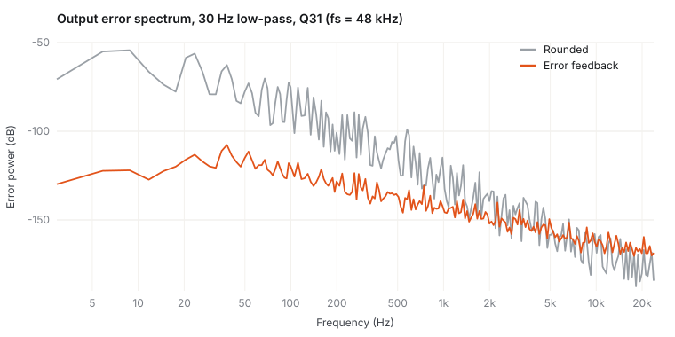

# qfx-dsp

**Fixed-point DSP for microcontrollers, measured rather than assumed.**

Q15 / Q31 primitives, a biquad cascade with error-feedback noise shaping, a mirrored-delay-line FIR and a wrap-around-safe CIC decimator. The library is portable C99 with no allocation and no dependencies. Every claim below comes from a test or an example in this repo.

[](https://github.com/dusancorlija/qfx-dsp/actions/workflows/ci.yml)



## Why this exists

Low-cutoff IIR filters are where fixed point hurts. A 10 Hz low-pass at 48 kHz has its poles within 0.13 % of *z* = 1. Every rounding error inside the loop is amplified by roughly 1 / (1 + a1 + a2), which here is about 10⁷. The result is a filter that is "Q31" on paper and closer to 16 bits in practice. Fed a DC input, it also settles thousands of LSBs away from the right answer (a dead band).

First-order **error feedback** carries each section's truncation error into the next sample. That puts a zero in the noise transfer function at DC, exactly where those poles amplify it. It costs one 64-bit add per sample.

## Results

Arithmetic noise only: the reference uses the *same quantised coefficients* in double precision. The input is a −6 dBFS tone at fc/4 (from `examples/noise_shaping.c`).

| Low-pass cutoff (fs = 48 kHz) | Rounded | Error feedback | Gain |
|---:|---:|---:|---:|
| 10 Hz | 99.7 dB | 163.2 dB | **+63.5 dB** |
| 30 Hz | 116.9 dB | 168.1 dB | +51.2 dB |
| 100 Hz | 135.7 dB | 174.2 dB | +38.6 dB |
| 300 Hz | 150.6 dB | 178.6 dB | +28.0 dB |
| 1 kHz | 165.6 dB | 183.3 dB | +17.6 dB |
| 3 kHz | 178.3 dB | 186.5 dB | +8.2 dB |
| 10 kHz | 187.9 dB | 186.2 dB | −1.7 dB |

DC accuracy of a 50 Hz low-pass with a constant input (`tests/test_filters.c`):

| | Mean output error |
|---|---:|
| Rounded | −11 510 LSB (dead band) |
| Error feedback | 0.13 LSB |

**What error feedback does *not* fix: coefficient quantisation.** Measured against the ideal double-precision coefficients, the 10 Hz filter only reaches 75 dB, because its b-coefficients are around 10⁻⁷ and lose most of their bits in Q31. For cutoffs below ~fs/1000, decimate first or use a coupled-form / state-variable structure. The example prints this column too.

## Usage

```c
#include "qfx/biquad.h"
#include "qfx/design.h"

static qfx_biquad_coef_t coef[2];
static qfx_biquad_state_t state[2];
static qfx_biquad_t lp;

void filter_init(void)
{
    qfx_sos_t sos[2];
    qfx_design_butter_lowpass(48000.0, 20.0, 4, sos); /* host or FPU target */
    for (int k = 0; k < 2; k++)
        qfx_biquad_coef_from_double(&coef[k], sos[k].b0, sos[k].b1, sos[k].b2,
                                    sos[k].a1, sos[k].a2);
    qfx_biquad_init(&lp, coef, state, 2, QFX_BIQUAD_NOISE_SHAPING);
}

void on_dma_half_complete(q31_t *block, size_t n)
{
    qfx_biquad_process(&lp, block, block, n); /* in place, any block size */
}
```

On targets without an FPU, run the design step on the host and paste the resulting `qfx_biquad_coef_t` initialisers into the firmware. Only `design.c` uses floating point.

## Design notes

| Decision | Reason |
|---|---|
| **Direct Form I**, not DF2T | One quantisation point per section, and the states are the bounded input and output signals. DF2T states can grow far past full scale for high-Q, low-frequency sections. |
| **Accumulate in `uint64_t`** | The partial sums of five Q62 products can overflow `int64_t` even when the final result fits. Signed overflow is undefined behaviour in C; unsigned wrap-around is not. Modular arithmetic makes the transient overflow harmless. |
| **Coefficient `shift` per section** | Coefficients are stored as c · 2^(31−shift). `shift = 1` covers every stable denominator (\|a1\| < 2); peaking sections with gain get `shift = 2`. Chosen automatically. |
| **Stage-outer loop** | Each section's five coefficients and four states stay in registers for the whole block. |
| **Mirrored FIR delay line** | Each sample is written twice, so the newest N samples are always contiguous. The MAC loop has no modulo or wrap branch, and four accumulators keep the multiplier pipeline busy. |
| **CIC in `uint32_t`** | Integrators wrap by design. The comb differences are exact as long as `input_bits + order·log2(R) ≤ 32`. Tested with a full-scale DC input that wraps the integrators thousands of times. |
| **Saturate, never wrap, at outputs** | An overdriven filter clips like analogue hardware instead of flipping sign. |

## Properties that are tested

- Bit-identical output for any block size (1, 7, 64, 1000 samples), in place or out of place
- SNR > 150 dB against a double reference for a 4th-order Butterworth
- Error feedback beats rounding by more than 20 dB at low cutoff, with DC bias under 0.5 LSB
- Correct saturation, including the −1 × −1 corner case
- 50 Hz notch rejects mains hum by more than 40 dB
- CIC: exact DC gain under integrator wrap-around, ragged input blocks
- No undefined behaviour: CI runs everything under ASan + UBSan with GCC and Clang

CI also cross-compiles the library for Cortex-M0+, M4F and M7 with `arm-none-eabi-gcc -Os` and reports the code size in the job summary.

## Build

```bash
cmake -S . -B build -DCMAKE_BUILD_TYPE=Release
cmake --build build
ctest --test-dir build --output-on-failure

./build/noise_shaping > docs/noise_shaping.csv   # SNR table on stderr
python3 tools/plot.py docs/noise_shaping.csv docs/noise_shaping.svg
./build/bench                                     # host throughput, float vs fixed
```

To use the library in firmware, add `src/biquad.c`, `src/fir.c`, `src/cic.c` and the `include/` directory to the project. There is no configuration header.

## Layout

```
include/qfx/   qfx.h (Q15/Q31 primitives), biquad.h, fir.h, cic.h, design.h
src/           implementations
tests/         dependency-free tests (check.h)
examples/      bench.c, noise_shaping.c
tools/plot.py  CSV -> SVG chart, standard library only
```

## License

MIT
